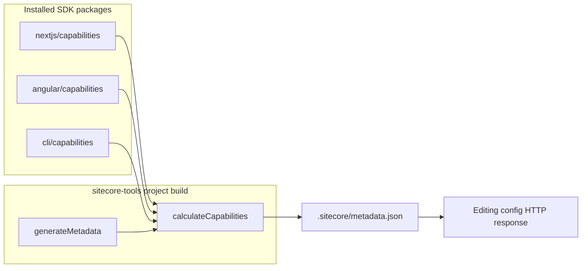

# Capabilities — reference (monorepo)

## Data flow

## Key files

| Area | Path |
|------|------|
| Contract types | `packages/core/src/capabilities.ts` |
| Collect / merge / resolve | `packages/core/src/tools/capabilities/index.ts` |
| Shared filter helpers | `packages/core/src/tools/capabilities/filter-utils.ts` |
| Metadata write | `packages/core/src/tools/metadata/generateMetadata.ts`, `metadata.ts` |
| Package discovery | `packages/core/src/tools/framework-packages.ts` |
| Next.js caps | `packages/nextjs/src/capabilities/` |
| Angular caps | `packages/angular/src/server/capabilities/` |
| CLI caps | `packages/cli/src/capabilities.ts` |
| E2E verify | `scripts/verify-sample-capabilities.js`, `scripts/e2e-sample-capabilities.js` |

## Current capability keys (contract)

See `CSDKCapabilities` in `packages/core/src/capabilities.ts`. Notable tree:

- Top-level: `preview`, `editing`, `abTesting`, `byocRender`, `feaasRender`, `designLibrary`
- Under `designLibrary.value`: `variantGeneration`, `variantPreview`, `aiComponentImport` (CLI)

## Merge semantics (short)

- Boolean `value: true` from multiple packages: OR
- Nested trees: deep merge by key
- Multiple `filter` functions on one node: all must pass (AND)
- `metadata` objects: shallow merge

## Editing config

- Next.js: `packages/nextjs/src/editing/editing-config-middleware.ts`
- Angular: `packages/angular/src/server/middleware/editing-config-middleware.ts`

Both attach `capabilities` from loaded metadata (empty object if missing).
